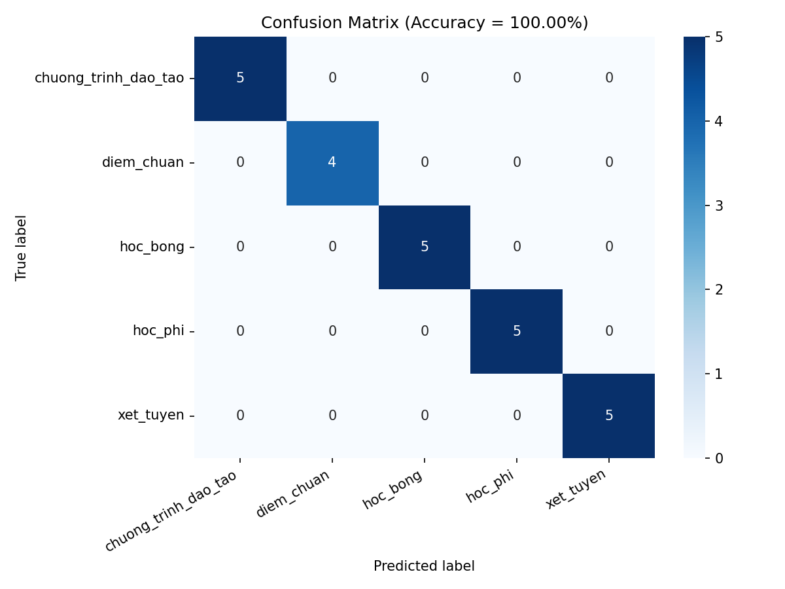

# Query Intent Classification with PhoBERT

A Vietnamese **query intent classifier** for university admission counseling, built by fine-tuning [`vinai/phobert-base-v2`](https://huggingface.co/vinai/phobert-base-v2) with PyTorch and Hugging Face Transformers. Given a user's question, the model predicts what the user wants to know: tuition, cut-off scores, admission methods, scholarships, or the curriculum.

> **Status:** educational / portfolio project. The dataset is small and hand-written, so please read the [Limitations](#limitations) section before interpreting the numbers.

## Intents

| Intent                | Meaning           | Example                                                               |
|---                    |---                |---                                                                    |
| `hoc_phi`             | Tuition and costs | *Học phí ngành Công nghệ thông tin một kỳ là bao nhiêu*               |
| `diem_chuan`          | Cut-off / admission scores | *Điểm chuẩn ngành Trí tuệ nhân tạo là bao nhiêu*             |
| `xet_tuyen`           | Admission methods, documents, deadlines | *Hồ sơ đăng ký xét tuyển gồm những giấy tờ gì*  |
| `hoc_bong`            | Scholarships      | *Điều kiện để nhận học bổng khuyến khích học tập là gì*               |
| `chuong_trinh_dao_tao`| Curriculum and programs | *Sinh viên phải học bao nhiêu tín chỉ để tốt nghiệp*           |

## Approach

1. **Data:** 120 hand-written Vietnamese questions (24 per intent) in `data/intent_data.csv`.
2. **Preprocessing:** Unicode normalization, noise removal, de-duplication, then a stratified 80/20 train/test split.
3. **Word segmentation:** `pyvi` joins syllables into words (e.g. `Công_nghệ_thông_tin`), because PhoBERT was pre-trained on word-segmented text.
4. **Fine-tuning:** PhoBERT encoder plus a classification head, trained with a plain PyTorch loop.
5. **Data augmentation (second iteration):** after error analysis (see below), the training set was augmented with accent-free and abbreviated variants of each sentence. Augmentation is applied **after** the split and **only to the training set** to avoid data leakage.

## Results

Two evaluation sets are used:

- `data/test.csv`: 24 held-out sentences, same style as the training data.
- `data/hard_test.csv`: 30 hand-written sentences in realistic user styles (accent-free typing, abbreviations, informal phrasing, indirect wording).

| Model                                      | Evaluation set     | Accuracy  | Macro F1           |
|---                                         |---                 |---        |---                 |
| Baseline (96 original training sentences)  | `test.csv`         | 100.00%   | 1.0000             |
| Baseline                                   | `hard_test.csv`    | 73.33%    | 0.7552             |
| + Data augmentation                        | `test.csv`         | 95.83%    | 0.9556             |
| + Data augmentation                        | `hard_test.csv`    | 96.67%    | 0.9664             |

The two sets measure different things, so their results are intentionally not pooled into a single number.

Confusion matrices (after augmentation):

| `test.csv`                                                   | `hard_test.csv`                   |
|---                                                           |---                                |
|  |  |

Full per-class precision, recall and F1 are in `assets/classification_report*.txt` and `assets/metrics*.json`.

### Error analysis

**Baseline.** The baseline scored 100% on the standard test set but only 73.33% on the hard set. All 8 errors were **accent-free inputs**, and **all 8 were predicted as `chuong_trinh_dao_tao`**; every one of the 15 inputs written with proper diacritics was classified correctly. A confidence threshold of 0.5 caught only 2 of the 8 errors, the other 6 were wrong with 54% to 78% confidence, so softmax confidence is not a reliable safety net.

**After augmentation.** One error remains on each evaluation set:

- `test.csv`: "Chuẩn đầu ra ngoại ngữ của trường là gì" (true: `chuong_trinh_dao_tao`, predicted: `diem_chuan`, confidence 60.4%).
- `hard_test.csv`: "hoc nganh nay mat may nam vay ad" (true: `chuong_trinh_dao_tao`, predicted: `hoc_phi`, confidence 93.2%).

The second error is notable for two reasons. First, the model is highly confident (93.2%) while being wrong, which again shows that softmax confidence cannot be trusted as an error signal. Second, the baseline classified this same sentence correctly. Since all 8 baseline errors were predicted as `chuong_trinh_dao_tao`, that earlier success may be a side effect of the baseline's bias toward this label rather than real understanding (an untested hypothesis). Both remaining errors are short questions that do not seem to contain the typical keywords of their intent, which suggests collecting more varied phrasings for each intent.
## Limitations

- **Tiny evaluation sets.** One sentence is worth 4.2% on `test.csv` and 3.3% on `hard_test.csv`. The drop from 100% to 95.83% on `test.csv` after augmentation is a single sentence, so it cannot be distinguished from noise.
- **`hard_test.csv` is optimistic.** It was used to diagnose the accent-free failure mode and to decide what to augment, so it behaves like a development set rather than a fully unseen test set. The improvement shows the augmentation fixes the *known* failure; it does not prove robustness to other typing styles.
- **Synthetic data.** All questions were written by the author, not collected from real users.
- **Closed-set classifier.** The model must choose one of five intents, even for off-topic questions. The confidence threshold in `predict.py` is a heuristic, not a real out-of-scope detector.
- **Vietnamese only.** PhoBERT is a Vietnamese model; English queries are not supported.
- **Approximate segmentation.** `pyvi` is used instead of the VnCoreNLP segmenter PhoBERT was originally trained with.
- **Ambiguous label boundaries.** Some questions legitimately fit two intents, e.g. tuition waivers (`hoc_phi` vs `hoc_bong`).

## Project Structure

```text
Query-Intent-Classification-BERT/
├── data/
│   ├── intent_data.csv       # raw dataset (text, intent)
│   ├── train.csv             # generated by preprocess.py (augmented)
│   ├── test.csv              # generated by preprocess.py
│   ├── hard_test.csv         # hand-written realistic test sentences
│   └── label_map.json        # generated label <-> id mapping
├── src/
│   ├── preprocess.py         # cleaning, split, augmentation
│   ├── train.py              # fine-tune PhoBERT
│   ├── evaluate.py           # metrics + confusion matrix
│   └── predict.py            # CLI demo
├── assets/                   # evaluation results and figures
├── requirements.txt
├── .gitignore
└── README.md
```

## Getting Started

### Option A: Google Colab (recommended, free GPU)

Select **Runtime > Change runtime type > T4 GPU**, then run:

```python
!git clone https://github.com/duymsdev/Query-Intent-Classification-BERT.git
%cd Query-Intent-Classification-BERT
!pip install -q pyvi
!python src/preprocess.py
!python src/train.py
!python src/evaluate.py
!python src/evaluate.py --test-file hard_test.csv --tag hard_after
```

### Option B: Local machine (Python 3.10 to 3.12 recommended)

```bash
git clone https://github.com/duymsdev/Query-Intent-Classification-BERT.git
cd Query-Intent-Classification-BERT
python -m venv venv
source venv/bin/activate        # Windows: .\venv\Scripts\Activate.ps1
pip install -r requirements.txt

python src/preprocess.py        # clean, split, augment
python src/train.py             # fine-tune and save the model to models/
python src/evaluate.py          # metrics + confusion matrix on test.csv
```

Trained weights are not committed (see `.gitignore`); run `train.py` to regenerate them.

## Demo

Single prediction:

```bash
python src/predict.py --text "Học phí ngành CNTT một kỳ bao nhiêu"
```

Interactive mode (type `q` to quit; in Colab use `%run src/predict.py`):

```bash
python src/predict.py
```

Example output (produced by the baseline model before augmentation; exact probabilities vary between training runs):

```text
Câu hỏi: "Học phí ngành CNTT một kỳ bao nhiêu"
=> Ý định dự đoán: hoc_phi (độ tin cậy 79.3%)
   Chi tiết xác suất:
   hoc_phi                 79.3% #######################
   chuong_trinh_dao_tao     5.9% #
   hoc_bong                 5.6% #
   diem_chuan               5.0% #
   xet_tuyen                4.1% #
```

## Training Details

| Setting | Value |
|---|---|
| Base model | `vinai/phobert-base-v2` |
| Optimizer | AdamW (weight decay 0.01), linear warmup 10% then linear decay |
| Learning rate | 3e-5 |
| Epochs / batch size | 10 / 8 |
| Max sequence length | 64 |
| Seed | 42 |
| Hardware | Google Colab |

## Future Work

- Add an explicit `out_of_scope` class (or a proper open-set detector) instead of relying on a confidence threshold.
- Collect real user queries and enlarge the dataset; evaluate with k-fold cross-validation for less noisy estimates.
- Support English queries with a multilingual encoder (e.g. `xlm-roberta-base`) and bilingual data.
- Calibrate prediction confidence (e.g. temperature scaling).
- Serve the model behind a small REST API.

## Acknowledgements

- [PhoBERT](https://github.com/VinAIResearch/PhoBERT) by VinAI Research.
- [Hugging Face Transformers](https://github.com/huggingface/transformers), [PyTorch](https://pytorch.org/), [scikit-learn](https://scikit-learn.org/), [pyvi](https://github.com/trungtv/pyvi).

## Author

Duy. GitHub: [@duymsdev](https://github.com/duymsdev)